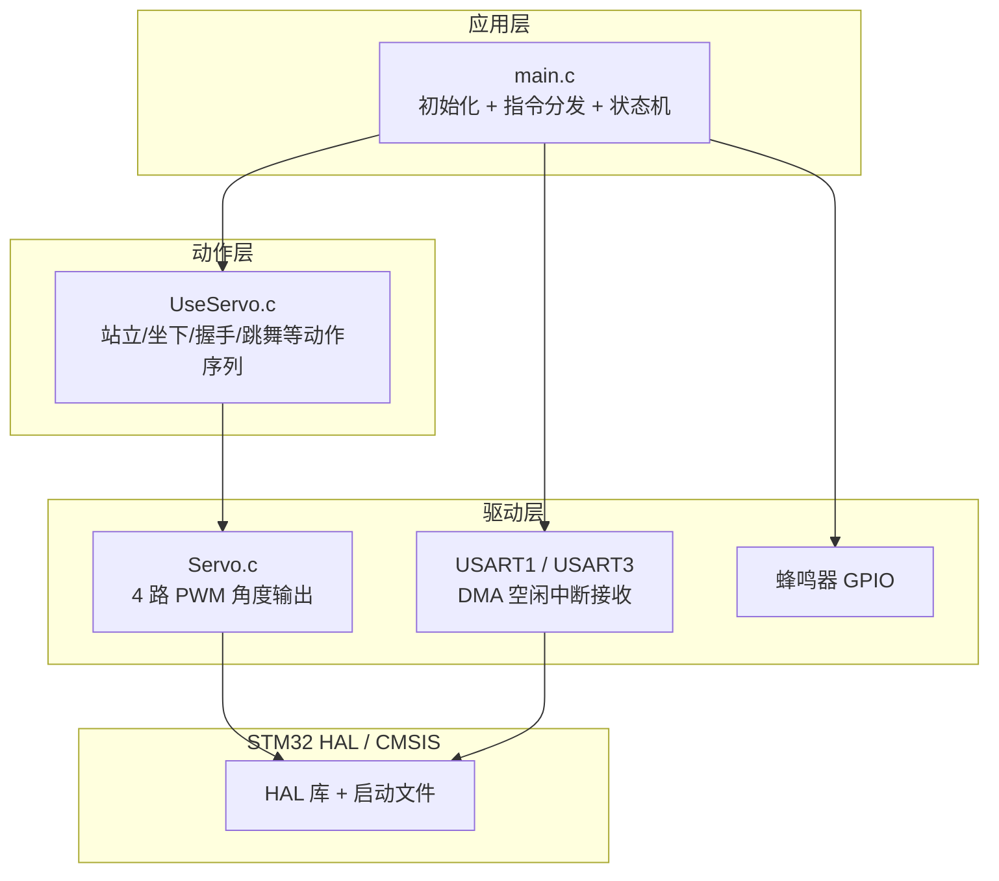
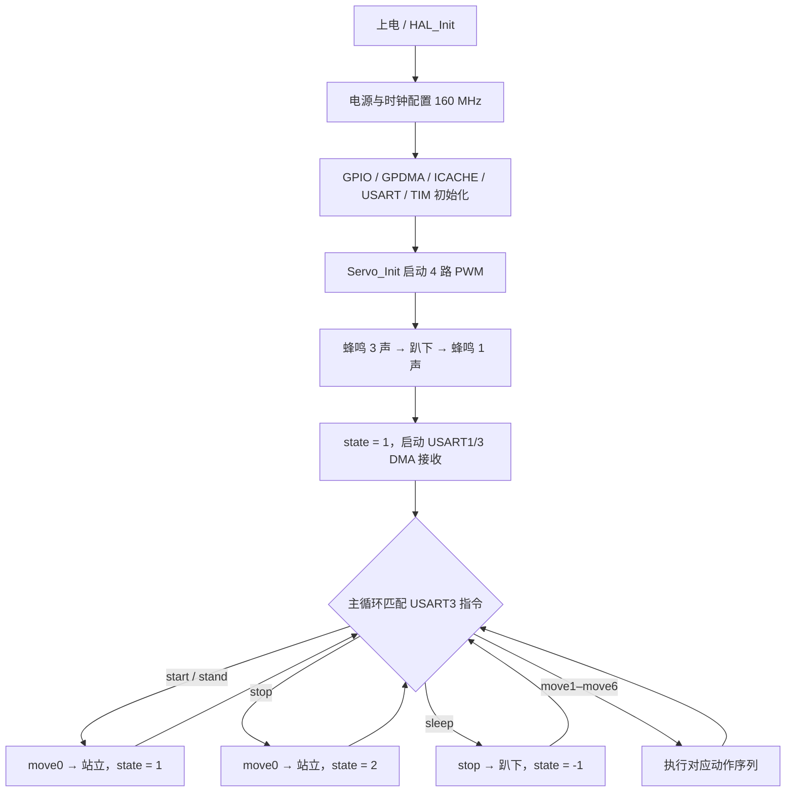
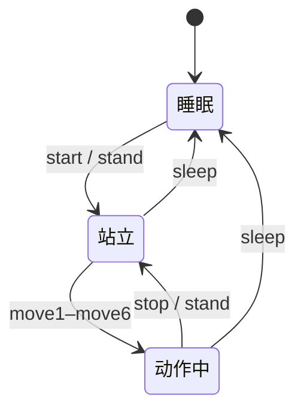

# 语音控制四足机器人 · STM32U575

**Voice-Controlled Quadruped Robot** — 基于 STM32U575 + HAL 的四足机器狗，离线语音指令驱动多舵机动作序列


> **English overview**
> A four-legged robot built on an **STM32U575RITx** (Cortex-M33, 160 MHz) and the **STM32 HAL**. An offline voice-recognition module sends ASCII commands over **USART3**; the firmware maps them to ten voice commands and multiple servo poses/actions across four **SG90** servos driven by **50 Hz PWM** (TIM3 / TIM15). UART reception uses **DMA idle-line** detection, with commands echoed to the debug console on **USART1**; a buzzer provides action feedback.
>
> **Keywords**: STM32U5 · HAL · PWM · UART · DMA · SG90 · Offline Voice · Quadruped Robot

---

## 目录

- [项目简介](#项目简介)
- [功能特性](#功能特性)
- [硬件设计](#硬件设计)
- [软件设计](#软件设计)
- [语音指令与动作](#语音指令与动作)
- [目录结构](#目录结构)
- [编译与烧录](#编译与烧录)
- [调试方法](#调试方法)
- [已知问题与改进计划](#已知问题与改进计划)
- [版权与致谢](#版权与致谢)

---

## 项目简介

本项目是一个面向嵌入式入门与机电控制的四足机器人：使用一块 STM32U575 最小系统板，通过离线语音识别模块接收语音指令，驱动 4 个 SG90 舵机完成站立、坐下、握手、跳舞等动作，并用蜂鸣器给出执行反馈。

项目重点在于：

- STM32U5 系列 HAL 库的工程配置与时钟 / PWM / UART / DMA 使用
- 离线语音模块的串口协议对接与命令映射
- 多舵机角度标定与动作序列设计
- 阻塞式动作函数与状态机配合的程序结构

---

## 功能特性

- **离线语音控制**：语音模块通过 USART3（115200 8N1）发送 ASCII 指令，无需联网或手机 App。
- **4 舵机四足结构**：每条腿一个 SG90，TIM3 / TIM15 输出 4 路 50 Hz PWM，脉宽 0.5–2.5 ms 对应 0–180°。
- **DMA 空闲中断接收**：USART1 / USART3 均使用 `HAL_UARTEx_ReceiveToIdle_DMA`，接收完成后回调并重新装载 DMA，避免轮询丢帧。
- **多组动作与姿势**：站立、趴下、坐下、握手、摔倒、伸懒腰、跳舞、攻击等，由 `UseServo.c` 组合舵机角度实现。
- **动作反馈**：`start` / `stop` 时 PA15 蜂鸣器鸣叫提示；USART1 实时回显语音模块指令，便于联调。
- **状态机管理**：`state = -1 / 1 / 2` 分别表示睡眠、站立待命、动作中；动作序列开始前通常先调用 `move0()` 回到站立过渡姿态。

---

## 硬件设计

| 项目 | 型号 / 参数 | 说明 |
| --- | --- | --- |
| 主控 | STM32U575RITx | Cortex-M33，160 MHz，2 MB Flash，786 KB SRAM |
| 舵机 | SG90 × 4 | 0–180°，50 Hz PWM，0.5–2.5 ms 脉宽 |
| 语音模块 | 离线语音识别模块 | UART TTL，115200 8N1，识别结果输出 ASCII 指令 |
| 蜂鸣器 | 有源蜂鸣器 | PA15 高电平驱动（经三极管更佳） |
| 调试 | ST-Link V2/V3 | SWD 下载与调试，USART1 可接 USB-TTL |
| 供电 | 外部 5 V ≥ 2 A | 4 个 SG90 堵转电流较大，**不要**直接从开发板 5 V 取电 |

### 引脚分配

| STM32 引脚 | 复用 / 功能 | 连接对象 | 说明 |
| --- | --- | --- | --- |
| PA9 | USART1_TX | USB-TTL RX / 调试串口 | 115200 8N1，打印与回显 |
| PA10 | USART1_RX | USB-TTL TX / 调试串口 | 接收调试输入并回显 |
| PA5 | USART3_RX | 语音模块 TX | 接收识别结果 |
| PA7 | USART3_TX | 语音模块 RX（可选） | 当前未发送数据 |
| PC6 | TIM3_CH1 | 左前腿 SG90 信号 | 角度反向映射 |
| PC7 | TIM3_CH2 | 左后腿 SG90 信号 | 角度反向映射 |
| PB15 | TIM15_CH2 | 右前腿 SG90 信号 | 角度直接映射 |
| PB14 | TIM15_CH1 | 右后腿 SG90 信号 | 角度直接映射 |
| PA15 | GPIO 输出 | 蜂鸣器 | 高电平鸣叫，`beepLoop()` 控制 |
| PC13 / PC4 | GPIO 输出 | 预留 | CubeMX 已初始化，当前代码未使用 |
| PA12 | EXTI 下降沿 | 预留 | 已配置中断，当前未编写回调逻辑 |
| PA1 | GPIO 输入 | 预留 | 已初始化，当前代码未使用 |

### 接线示意

```text
                    STM32U575RITx
                 ┌─────────────────┐
 语音模块 TX ───►│ PA5  (USART3_RX)│
 语音模块 RX ◄───│ PA7  (USART3_TX)│   (可选)
 USB-TTL RX ◄───│ PA9  (USART1_TX)│
 USB-TTL TX ───►│ PA10 (USART1_RX)│
                 │                 │
 左前舵机 ◄──────│ PC6  (TIM3_CH1) │
 左后舵机 ◄──────│ PC7  (TIM3_CH2) │
 右后舵机 ◄──────│ PB14 (TIM15_CH1)│
 右前舵机 ◄──────│ PB15 (TIM15_CH2)│
                 │                 │
 蜂鸣器  ◄───────│ PA15            │
                 └─────────────────┘
外部 5V 电源 ──► 4× SG90 VCC，GND 与主控共地
```

> 舵机电源必须与主控共地；建议在舵机电源端并联 1000 µF 以上电解电容，抑制同时启动造成的电压跌落与复位。

---

## 软件设计

### 分层结构



### 时钟与 PWM

- 系统时钟：MSI → PLL（M=3，N=10，P=2），SYSCLK = **160 MHz**，HCLK = 160 MHz。
- TIM3 / TIM15：预分频 `160 - 1`，计数周期 `20000`，即 **1 MHz 计数、约 20 ms 周期、约 50 Hz**。
- 舵机角度换算：

```c
// 右前 / 右后：角度直接映射
CCR = Angle / 180 * 2000 + 500;

// 左前 / 左后：舵机镜像安装，角度取反
CCR = (180 - Angle) / 180 * 2000 + 500;
```

`Servo_Angle1..4()` 分别对应左后（PC7）、左前（PC6）、右前（PB15）、右后（PB14），映射关系集中在 `Servo.c` 中封装，便于单独标定。

### UART + DMA 接收

- USART1、USART3 均配置为 115200 8N1；GPDMA1 通道 0/1 分别服务 USART1_RX、USART3_RX。
- 上电后调用 `HAL_UARTEx_ReceiveToIdle_DMA(&huartX, buf, sizeof(buf))`；空闲中断触发 `HAL_UARTEx_RxEventCallback()`。
- 回调中：USART1 收到的数据回显到 USART1；USART3 收到的数据转发到 USART1（调试口），并重新装载 DMA。
- 主循环轮询 `DataBuff3`，用 `strcmp` 匹配 `"start\r\n"`、`"stand\r\n"`、`"move1\r\n"` 等指令。

### 程序流程



### 状态机



- `state = -1`：睡眠 / 趴下（四腿 180°）
- `state = 1`：待命（通常由 `move0()` 进入站立姿态 90°）
- `state = 2`：动作执行中 / 动作结束
- 多数动作开始前先调用 `move0()`，从当前姿态回到站立过渡姿态，再执行目标动作。

---

## 语音指令与动作

语音模块需配置为在识别成功后通过串口输出对应 ASCII 字符串，并以 `\r\n` 结尾。

| 指令 | 处理函数 | 动作描述 | 结束状态 |
| --- | --- | --- | --- |
| `start` | `move0()` | 从趴下起身站立，进入待命 | 1 |
| `stand` | `move0()` | 站立 / 回到站立姿态 | 1 |
| `stop` | `move0()` | 停止当前动作，回到站立 | 2 |
| `sleep` | `stop()` | 四腿收至 180°，趴下休眠 | -1 |
| `move1` | `move0()` → `move1()` | 摔倒 | 2 |
| `move2` | `move0()` → `move2()` | 握手 | 2 |
| `move3` | `move0()` → `move3()` → `move0()` | 伸懒腰 | 1 |
| `move4` | `move0()` → `move4()` | 坐下 | 1 |
| `move5` | `move5()` | 跳舞（左右两组姿态交替） | 2 |
| `move6` | `move6()` | 攻击（三段连续姿态） | 2 |

> 动作角度在 `UseServo.c` 中以常量形式写死，更换舵机或调整机械安装角度后需要重新标定。`Servo.c` 中的镜像映射负责抵消左右腿的对称安装差异。

---

## 目录结构

```text
-STM32U575-/
├── Core/
│   ├── Inc/                  # HAL 配置与用户头文件
│   │   ├── main.h
│   │   ├── Servo.h           # 舵机 PWM 接口
│   │   ├── UseServo.h        # 动作序列接口
│   │   ├── tim.h / usart.h / gpio.h / gpdma.h / icache.h
│   │   └── stm32u5xx_hal_conf.h
│   └── Src/
│       ├── main.c            # 初始化、DMA 接收回调、指令分发
│       ├── Servo.c           # 4 路 PWM 启动与角度换算
│       ├── UseServo.c        # 站立/坐下/握手/跳舞等动作
│       ├── tim.c / usart.c / gpio.c / gpdma.c / icache.c
│       └── stm32u5xx_it.c    # 中断向量
├── Drivers/                  # STM32U5 HAL 与 CMSIS（原厂）
├── MDK-ARM/
│   ├── dog.uvprojx           # Keil MDK 工程
│   ├── startup_stm32u575xx.s
│   ├── dog_dog.sct           # 分散加载文件
│   └── dog/                  # 编译中间文件（.o/.d）
├── dog.ioc                   # STM32CubeMX 工程配置
├── dog.csolution.yml         # CMSIS-Toolbox / Keil Studio 工程描述
├── vcpkg-configuration.json
└── README.md
```

---

## 编译与烧录

### 环境

- **Keil MDK-ARM 5.32+**（工程由 CubeMX 以 MDK-ARM V5.32 生成）
- STM32U5 系列 Device Family Pack（`Keil.STM32U5xx_DFP`）
- ARM Compiler 6（AC6）
- ST-Link 驱动与 STM32CubeProgrammer（或 Keil 内置下载）

### 步骤

1. 打开 `MDK-ARM/dog.uvprojx`。
2. 在 `Options for Target` 中确认器件为 **STM32U575RITx**，下载器选择 **ST-Link Debugger**。
3. `Project → Rebuild all target files` 全量编译（仓库内附带旧 `.o/.d` 文件，建议先 Clean）。
4. `Flash → Download` 烧录，复位运行。

> 也可用 STM32CubeMX 打开根目录 `dog.ioc` 修改外设配置后重新生成代码。用户代码位于 `/* USER CODE BEGIN ... */` 与 `/* USER CODE END ... */` 之间，重新生成时会被保留；`main.c` 中的指令分发与回调务必写在对应区块内。
>
> 若使用 Keil Studio / CMSIS-Toolbox，可直接打开 `dog.csolution.yml`，依赖由 `vcpkg-configuration.json` 管理。

### 语音模块配置

1. 通过模块厂商的上位机配置识别词条，例如「开始」「站立」「趴下」「跳舞」等。
2. 将每个词条的串口输出分别设置为 `start\r\n`、`stand\r\n`、`sleep\r\n`、`move5\r\n` 等。
3. 波特率 115200、8 数据位、无校验、1 停止位；模块 TX 接 PA5，GND 与主控共地。

---

## 调试方法

- **串口回显**：USART1（115200 8N1）会回显 USART1 与 USART3 收到的全部内容，可用来确认语音模块是否按预期输出指令（包括 `\r\n`）。
- **蜂鸣器**：上电鸣叫 3 声，初始化完成后再鸣 1 声；`start` / `stop` 指令各鸣叫 1 声，其余动作无蜂鸣。
- **角度标定**：先将四腿统一设为 90° 检查机械中位，再逐个调整 `UseServo.c` 中的角度常量，避免舵机堵转。
- **供电检查**：多舵机同时动作时若主控复位或语音模块掉线，优先检查 5 V 电源能力与共地。

---

## 已知问题与改进计划

| 类别 | 当前状态 | 建议 |
| --- | --- | --- |
| 实时性 | 动作函数内部使用 `HAL_Delay()`，单次动作阻塞 0.4–5 s | 改为非阻塞状态机 / 定时器调度，或迁移到 FreeRTOS |
| 指令解析 | `strcmp` 严格匹配「指令 + `\r\n`」；一包多指令、粘包/半包无法处理 | 增加环形缓冲、按行分割与校验 |
| 动作被打断 | 动作执行期间无法响应新指令 | 动作拆分为帧，主循环按节拍推进，支持急停 |
| 代码完整性 | `UseServo.h` 声明了 `move7()`，但未实现 | 删除声明或补齐实现 |
| 状态切换 | `move0()` 的 `case -1` 分支无 `break`，依赖贯穿进入站立分支 | 改为显式过渡函数，避免后续维护误改 |
| 注释编码 | `main.c` 部分中文注释为 GBK/乱码，显示为「锟斤拷」 | 统一转为 UTF-8 并清理历史注释 |
| 工程规范 | 提交了 `.o/.d/.uvguix` 等构建产物；无 `.gitignore`、无 LICENSE | 添加 `.gitignore`（`MDK-ARM/dog/`、`*.uvguix.*`、`Objects/`、`Listings/`）并明确许可证 |
| 结构自由度 | 每条腿仅 1 个舵机，无膝关节，步态能力有限 | 升级为 8/12 自由度，配合 PCA9685 与逆运动学 |
| 感知能力 | 纯开环，无姿态 / 距离反馈 | 增加 IMU（如 ICM42688）与 ToF，实现自平衡 / 避障 |
| 演示材料 | 仓库无接线图、演示视频 | 在 `docs/` 中补充 GIF / 视频与接线照片，README 顶部引用 |

### Roadmap

- [ ] 非阻塞动作调度器，支持动作打断与急停
- [ ] 串口协议增加帧头、长度与校验
- [ ] 8/12 自由度升级与逆运动学步态
- [ ] IMU 姿态反馈与自平衡
- [ ] ToF 避障与超声跟随
- [ ] 蓝牙 / 手机 App 控制
- [ ] 清理构建产物，补充 `.gitignore` 与演示资料

---

## 版权与致谢

- `Drivers/` 下的 STM32U5 HAL 驱动与 CMSIS 组件版权归 STMicroelectronics / Arm 所有，按其各自许可证分发。
- 应用层代码（`Core/` 下用户编写部分）用于学习与作品展示，仓库暂未声明开源许可证，如需引用或复用请联系作者。

**作者**： [GitHub @A-goldstar](https://github.com/A-goldstar)

> 调试舵机时请使用独立稳压电源并固定机器人，避免堵转过热或突然动作造成损坏。
